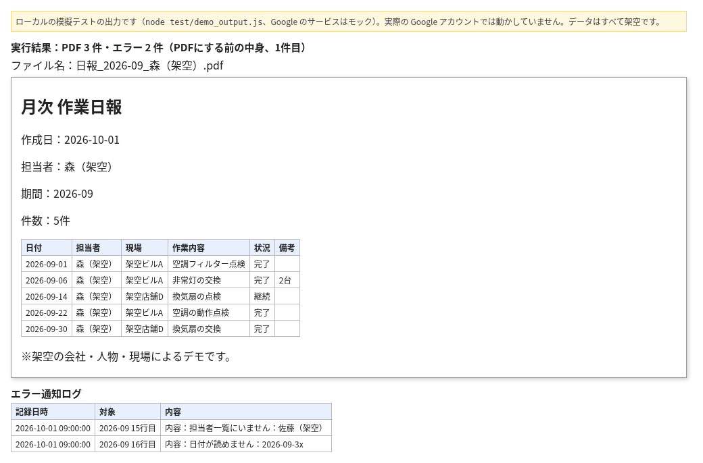
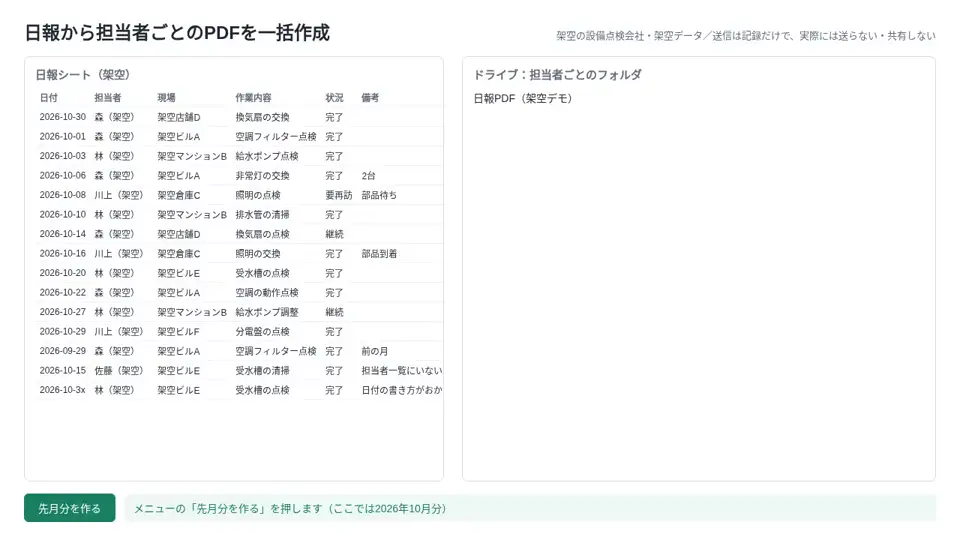
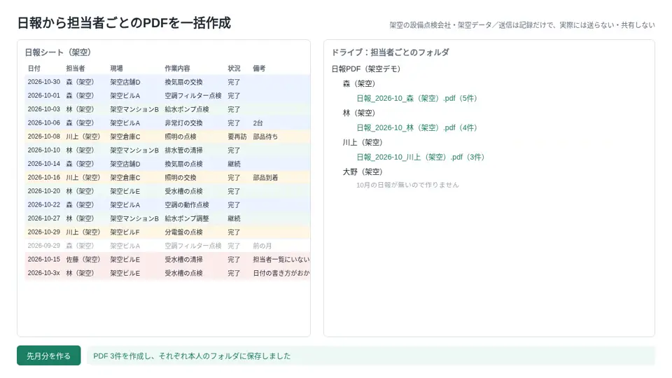

# 日報シートから担当者ごとの月次PDFを作る（GAS見本）

設備点検などの会社で、月初めに先月の日報を担当者ごとに分けてPDFにしている事務の方向けです。

2026-10-01 に作った想定で、架空の9月分の日報から3人分のPDFを作り、担当者一覧にない人と読めない日付の2行をエラー通知ログに残した結果です。画像は1人目の中身です。上の画像は、ローカルの模擬テスト（`node test/demo_output.js`、Google のサービスはモック）の実際の出力から作りました。実際の Google アカウントでは動かしていません。

**効果：** 担当者ごとに手で分けてPDFにしていた作業が、メニューを1回押すだけで全員分そろいます。

架空の設備点検会社のデータで動きます。登場する会社・人物・現場はすべて架空です。

## 課題
毎月、日報を担当者ごとに分けてPDFにし、フォルダに保存して、送る準備をしていました。
入れる人や保存先の間違い、同じものの作り直しが起きやすい作業でした。

## 仕組み
1. 「日報」シートの先月分を担当者ごとに分ける
2. 1人1つのPDF（日付順、担当者・期間・件数つき）を作り、担当者ごとのフォルダに保存
3. 「作成記録」シートで確かめ、同じ期間・担当者のPDFは二度作らない
4. 送る予定（宛先・件名・ファイル）を「送信予定」シートに記録する（送信も共有もしない）
5. 担当者一覧にいない人、日付が読めない行は止めて「エラー通知ログ」に記録

## 効果
| | 作る前 | 作った後 |
|---|---|---|
| 毎月のPDF作成と保存 | 担当者ごとに手で作って保存 | メニュー1回で担当者ごとに作って保存 |
| 送る準備 | 宛先とファイルを1件ずつ確認 | 送信予定の一覧で確認 |
| 作り直し | 同じものが重なりやすい | 同じ月の分は二度作らない |

ローカルの模擬テスト（`node test/run.js`、Google のサービスはモック）で50件すべて通ることを確かめています。

## 画面
説明用に作った図です（実際の Google の画面ではありません）。

## 設置の手順
1. 新しいスプレッドシートを作り、「拡張機能」から Apps Script を開く
2. src/ の .gs ファイルを同じ名前で作って中身を貼り付け、appsscript.json も置き換える
3. 「サービス」から Drive API（v3）を追加する
4. resetDemo を1回実行して架空の日報を入れる（初回は権限の許可が出ます）
5. メニューから先月分またはデモの月の作成を実行する

## 止まるときと記録
- PDFにできなかったときは止めて記録し、作業用のドキュメントは残しません。直った次の実行で続きから作ります
- 中身がないごく小さいPDFになったときも、保存せずに止めて記録します

## ファイル
| ファイル | 役割 |
|---|---|
| src/Config.gs | シート名・フォルダ名・1回の上限 |
| src/SeedData.gs | 架空の日報と担当者 |
| src/Code.gs | PDF作成の流れ・送信予定の記録・デモの初期化 |
| src/Pdf.gs | PDFへの変換と保存・1日の上限 |
| src/Notify.gs・Common.gs | 通知文・共通の処理 |
| test/ | Node.js で動くテスト（demo_output.js は冒頭の画像の元になる出力） |

## 作りの工夫
- テスト：`node test/run.js`（Google のサービスを偽物に置き換えて Node.js で動かします。実際の Apps Script では動かしていません）
- 二重処理の防ぎ方：「作成記録」シートを src/Code.gs の madeKeys_ で読み、作成済みの期間・担当者は飛ばす。makeReports から makeReportsLocked_ でロックを取って動かす
- 6分制限：1回に作る数を src/Config.gs の maxPerRun（10件）で止め、残りは次の実行で続きから作る。1日の上限は src/Pdf.gs の dailyLimit
- 外への通信は Google 自身のPDF変換の1か所だけ（テストで確認）

## 注意
- 架空のデータで動く見本です。実際の運用前に、自分の環境で動きを確かめてください
- Gmail・ドライブ・Apps Script には1日の上限があります

## 作った人
Reypage｜GAS業務自動化

## In English

A Google Apps Script sample that builds one monthly PDF per person from a work report sheet. All data is fictional (a facility inspection company).
It splits last month's rows by person, creates a PDF for each (sorted by date, with person, period and row count), and saves it in that person's Drive folder.
A log sheet prevents making the same person and month twice. Planned emails are listed in a sheet, and nothing is sent or shared.
Rows with an unknown person or an unreadable date stop the run and go to an error log sheet.
How to try it:
1. Create a new spreadsheet and open Apps Script from Extensions.
2. Paste each `.gs` file in `src/`, replace `appsscript.json`, and add the Drive API (v3) service.
3. Run `resetDemo` once to load sample data, then create the PDFs from the menu.
4. Local tests with mocked Google services: `node test/run.js`. The image at the top is built from `node test/demo_output.js` on the same mocks. Not yet run in a real Apps Script project.

## ライセンス
MIT（LICENSE を参照）
